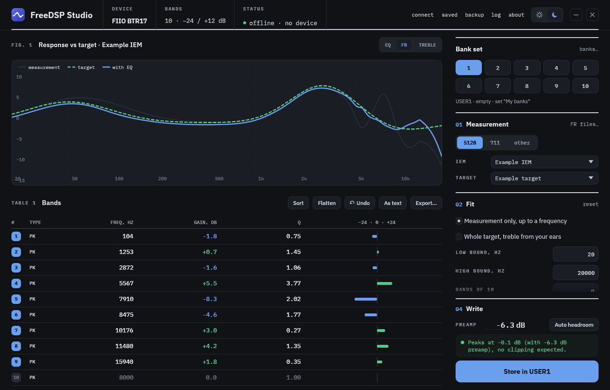

# FreeDSP Studio

An EQ editor for USB-C DSP cables and dongles — Moondrop's DUSK-SP, MAY and FreeDSP, the newer FreeDSP Mini, and Walkplay-chipset devices sold under other brands such as the CrinEar Protocol Micro, and FiiO's BTR17. It reads whatever EQ is on the cable, lets you edit the parametric bands by dragging points on the response curve, imports from squig.link, and writes it back. Built in Rust with Tauri, so it's a few MB of native app rather than a bundled browser. Runs on Windows and macOS.

I made this because the stock app is clunky, locked to whole-dB steps, and it turns out the cable can do WAY more than the app lets on.

> Independent project. Nothing to do with Moondrop, CrinEar, FiiO or any other manufacturer here — not affiliated, not endorsed. For cables you own.



## Download

From the [latest release](https://github.com/EffectiveEquivalent/FreeDSP-Studio/releases):

| | | |
|---|---|---|
| **Windows** | `FreeDSP-Studio.exe` | Single portable exe, nothing to install |
| **macOS** | `FreeDSP-Studio-macOS.dmg` | Universal, runs on Apple Silicon and Intel |

**Heads up: neither build is signed, so your OS will warn you about it.** Signing costs money per year on both platforms and this is a free project.

**Windows** shows a SmartScreen "unknown publisher" warning for any exe it hasn't seen before. That's a reputation check, not a virus detection. Click More info, then Run anyway. Signed releases via [SignPath](https://signpath.org) are in the works.

**macOS** shows "Apple could not verify FreeDSP Studio is free of malware". The app *is* ad-hoc signed, which is what lets it run on Apple Silicon at all, but it isn't notarised, and only notarisation clears that message. To get past it: try to open the app, dismiss the refusal, then go to **System Settings > Privacy & Security**, scroll down, and click **Open Anyway**. Note the old right-click > Open shortcut no longer works on current macOS. If you prefer the terminal:

```bash
xattr -dr com.apple.quarantine "/Applications/FreeDSP Studio.app"
```

Either way you only do it once. Or run from source (below), which avoids the whole thing.

## Supported cables

There are two generations of cable, speaking two unrelated protocols, plus FiiO's own protocol. The app detects which by asking, so a cable not listed here will still work if it answers the gen-2 handshake.

**Gen 1** — HID report `0x01` over the control pipe, 9 bands:

| Cable | USB ID (VID:PID) | Firmware presets |
|---|---|---|
| Moondrop DUSK-SP | `35D8:1499` | Crinacle tunings |
| Moondrop MAY | `35D8:1497` | Standard / Bass Head / Reference / No Bass / Harman |
| Moondrop FreeDSP | `35D8:1496` | none (custom bank only) |

**Gen 2** — HID report `0x4B` over the interrupt endpoints, 8 bands, with a real preamp register:

| Cable | USB ID (VID:PID) | Bands | Gain | Filter types | Firmware presets |
|---|---|---|---|---|---|
| Moondrop FreeDSP Mini | `35D8:98D4` | 8 | ±12 dB | PK / LS / HS | Default, Bass Enhance ×2, Space, Treble Enhance |
| CrinEar Protocol Micro | `3302:C20F` | 8 | ±10 dB | PK / LS / LPF / HPF | none (custom bank only) |

**FiiO** — HID report 7 over the interrupt endpoints, framed with a CRC-8. The device designs its own filters from freq / gain / Q, and holds ten writable USER banks:

| Device | USB ID (VID:PID) | Bands | Gain | Filter types | Banks |
|---|---|---|---|---|---|
| FiiO BTR17 | `2972:0088` | 10 | −24 / +12 dB | PK / LS / HS | USER1–10, plus the factory voicings and bypass |

The BTR17 only shares its EQ with EQ switched on in its settings; the app tells you if it's off. Other FiiO models need their bank layout worked out first, so they aren't picked up yet.

Plug in more than one and the app asks which to drive.

Windows and macOS. The gen-1 HID transport is split per platform — Windows goes at `hid.dll` directly, macOS goes through hidapi onto IOKit — so Linux is a small step from here: hidraw supports the same two calls and slots in beside the macOS backend. Gen 2 needs neither, being plain interrupt reads and writes, so it already runs through hidapi on every platform. Linux needs a udev rule granting access to VID `35d8`, `3302` and `2972`, and someone with a cable to test it.

## What it does

- Detects the cable and pulls in whatever EQ is loaded on it
- Parametric EQ — 9 bands on gen-1 cables, 8 on gen-2 — with the filter types and gain range each cable actually supports.... drag the numbered nodes straight on the graph, or type exact values (`8k`, `-3.5`, `0.71`; arrow keys nudge)
- Proper fractional-dB gain, not the whole numbers the stock app limits you to (see below)
- A real preamp, with an auto headroom button and a clip check before every write
- Switches the active firmware profile on the DUSK, MAY and FreeDSP Mini, and the active bank on the BTR17
- Bank sets on the BTR17: name all ten USER banks, drag them into order, and read or write the whole set at once. Write all skips banks that already match, checks each one it writes, and keeps whatever it overwrote as a set you can write back
- Works without a device: design for a BTR17 bank set, or a generic device with 1 to 10 bands, and write it when you next plug in
- squig.link / AutoEQ import and export (Equalizer APO parametric text): drop an EQ file on the window to apply it, or Export to save one
- Drop an FR file on the window to add it as a measurement or target, with its name and rig
- Frequency-response view: load your IEM's measurement and a target, see the EQ'd result
- Auto-fit the EQ to a target (based on AutoEq): either up to a frequency, leaving the rest of the bands free, or over the whole target using your treble correction
- Treble listening test: a listening test through the cable that finds the peaks and dips your ear hears above ~6 kHz, where a 711 can't be trusted. Two methods: "stands out" (does a band poke out of pink noise?) and "louder / quieter" (match neighbouring bands by level). Saved per IEM, tip and method, reused with any target, and switchable on and off in the FR view
- Saves your EQs as plain JSON files you can back up or share
- Nothing touches the cable until you hit Write

## The interesting bits

I reverse engineered the cable's HID protocol to build this, and a few genuinely cool things fell out of it:

**The EQ lives on the cable, not the app.** The DSP chip has its own memory. Whatever you write follows the cable to any phone or laptop with zero software running.

**The whole-dB limit isn't real.** Each band stores two separate things: a little metadata record where gain is a whole-dB integer, and the actual biquad filter coefficients that do the DSP. The metadata is basically a label for the app to display. The sound comes ENTIRELY from the coefficients, which are computed at full precision, so 2.3 dB really is 2.3 dB.... it just reads back as 2 because the readable field can't hold decimals. Proved on hardware by writing metadata that said 0 dB with coefficients for a -12 dB shelf: read-back said flat, the bass was audibly gone.

**The preamp is the bit I'm most chuffed with.** The cable has no preamp register at all. But scaling one band's biquad numerator by `k = 10^(preamp/20)` shifts that filter's response by a flat amount at every frequency, and because the 9 bands are cascaded, the WHOLE combined curve moves down with its shape intact. A mathematically exact preamp riding on a filter that's already there, costing nothing. It sits on the last active band so the rest of the chain runs hot (better signal-to-noise, thanks to oratory1990 for the nudge).

Nerdy footnote: a gen-1 cable stores a separate coefficient set per sample rate (44.1 / 48 / 96 / 192 / 384 kHz), fixed-point scaled by 2^22. Silicon is a Conexant CX2077x-class DSP; control is HID over USB.

**Gen 2 is a different animal.** Report `0x4B`, framed as `[OP, CMD, LEN, payload]`, and — unlike gen 1 — replies come back on the interrupt endpoint rather than the control pipe. That difference is why these cables can be driven from a browser where gen-1 ones cannot: WebHID can send an output report and listen for input reports, but cannot issue a control-pipe `GET_REPORT`, which is exactly what gen 1 needs and exactly why this app exists.

Each band carries both the coefficients it runs (one set at 96 kHz, fixed-point scaled by 2^30) and a freq/Q/gain/type record for read-back, written together in a single 33-byte payload. There is a genuine preamp register here, so none of the numerator trickery above is needed. Writes are latched with a coefficient-commit command and then persisted to flash, so they survive unplugging.

One wrinkle worth recording: replies are tagged only with the command they answer, and several different questions share command `0x09` — reading a band and reading the active EQ slot both use it. Leave a stale reply in the queue and the next request happily consumes it, after which every answer is off by one. Draining before each send, and checking the band index the cable echoes back, is what keeps that honest.

## Run from source

You'll need [Node.js](https://nodejs.org/) and the [Rust toolchain](https://rustup.rs/), plus:

- **Windows** — the MSVC C++ build tools (Visual Studio or the standalone Build Tools). WebView2 is already on any normal Windows 11 install.
- **macOS** — the Xcode Command Line Tools (`xcode-select --install`). WKWebView is part of the OS.

```bash
git clone https://github.com/EffectiveEquivalent/FreeDSP-Studio.git
cd FreeDSP-Studio/tools/app
npm install
npx tauri dev
```

## Build a release

Windows, portable exe into `tools/app/src-tauri/target/release/`:

```bash
npx tauri build --no-bundle
```

macOS, universal .app and .dmg into `tools/app/src-tauri/target/universal-apple-darwin/release/bundle/`:

```bash
npx tauri build --target universal-apple-darwin --bundles app,dmg
```

The macOS bundle is ad-hoc signed automatically (`signingIdentity: "-"` in `tauri.macos.conf.json`) — free, no Apple account, and required for the app to launch on Apple Silicon. It is not notarisation, so the Gatekeeper warning above still applies to anything downloaded. Running from source avoids both platforms' warnings entirely.

## Safety

Nothing is written until you click Write, writes are reversible, and the clip check won't let you push a distorting EQ without sorting the headroom first. Still: use at your own risk.

## Reverse engineering

This is a clean, independent implementation of the wire protocols, written for interoperability with hardware I own. There is no manufacturer code, firmware or assets in here.

## Support

If this saved you from the stock app, you can [buy me a coffee](https://buymeacoffee.com/effectiveequivalent). No pressure.

## Changelog

### 0.6.2
- Dropping both channels of a measurement together (squig's "Name [1].txt" and "Name [2].txt", or L/R) now adds one curve averaged the way squig.link plots it, so an auto-fit made in the app matches what squig shows. A single channel dropped alone is still added, with a note that it isn't the average

### 0.6.1
- Fix: BTR17 writes could lose bands at the next power-off. The BTR17 saves each band to flash as it arrives, but skips any that arrive less than about 50 ms after the previous one, and 0.6.0 sent them 20 ms apart, so bands 5 and 9 of every write were kept only until the device was switched off. Bands are now sent 150 ms apart, and every write is checked against what the device actually saved, by switching to another bank and back (which reloads the saved copy), instead of against its working copy. You'll hear the other bank for a moment. **If you wrote banks with 0.6.0, write them again**: Write all will find the ones that no longer match

### 0.6.0
- FiiO BTR17 support: read and write any of its ten USER banks, switch banks, and a per-bank preamp (its global gain). Bank switches wait for the device to settle, since for up to 0.7 s afterwards it still reports the previous bank's EQ, which is what makes FiiO's own web app show the wrong curve. The app also never sends the command FiiO's code calls factory reset, which another tool sends as "save" on this device
- Bank sets: name, order, sort, read all and write all for the BTR17's banks, with an automatic copy of whatever a write overwrote
- No-cable mode: design for a BTR17 bank set or a generic 1 to 10 band device without anything plugged in
- Drag and drop: a squig / AutoEQ / APO parametric EQ is applied to the current EQ; a frequency response asks for a name, rig (711 by default) and source or target
- Export the EQ as a parametric .txt
- The graph's floor follows the device, down to -24 dB on the BTR17
- Low-pass and high-pass filters survive a round trip through EQ text instead of turning into peaking filters

### 0.5.2
- Auto-fit now spends the bands you ask for. Since 0.4.0 it dropped any band that improved the overall error by less than 0.15 dB, and because that error is averaged over the whole fit range, bands fixing real 1 dB wiggles were thrown away: with 8 bands it typically used about 4. Bands are now only dropped if they do essentially nothing (under 0.02 dB). On 31 test IEMs this took the fit from about 4 to 7 bands used and cut the error by 20 to 30%. To keep bands free for hand tuning, lower the Bands count
- After a whole-target fit the FR view switches to the treble-corrected view, where the target is drawn the way the fit aims at it (its broad shape above ~6 kHz) with the raw target dotted behind it

### 0.5.1
- Auto-fit no longer puts two bands on top of each other (e.g. 7106 and 7120 Hz). The whole-target fit did this most, when a narrow treble feature was only half covered by the band placed on it; the range fit did it occasionally. Bands within a twelfth of an octave are now folded into one filter, and the whole-target fit re-places the freed band where the most error is left. On 32 test IEMs, stacked pairs went from 10 to 0 in each mode, with the whole-target fit slightly more accurate overall (0.325 to 0.312 dB RMS)

### 0.5.0
- **Treble listening test.** A 711 coupler can't be trusted above about 6 kHz, and everyone's ears differ up there anyway, so the treble can now be set by ear through the cable. Two methods: *stands out* (does a band poke out of pink noise?) and *louder / quieter* (match neighbouring bands by level, solved together so small errors don't pile up). Quick or thorough, keyboard driven (arrows, space, R / V, Backspace to undo). Results are kept per IEM and tip
- Use the result two ways: **Apply to EQ** turns it straight into treble bands in the EQ's flat slots (no measurement needed), or the **whole target + treble correction** auto-fit spends every band over the full range, using the smoothed rig level, the target's broad shape and your profile above ~6 kHz instead of the rig's treble detail, up to an upper limit you set. The FR view's TREBLE switch shows the measurement with and without the correction
- **New layout.** A datasheet-style header with the connected cable's details, the graph as Fig. 1 and the bands as a table (Table 1), and the workflow as numbered steps: measurement, fit, treble by ear, write. Auto-fit settings are on screen instead of in a dialog; saved EQs open from the header
- Band frequency, gain and Q, and the preamp, are typed instead of dragged on sliders: `8k`, `-3.5`, `0.71`; arrow keys nudge, Shift for bigger steps

### 0.4.0
- Auto-fit rewritten so it lands where squig.link's Auto EQ does. The old fit searched each band's frequency across the whole range with a method that assumes a single minimum, so bands teleported across the spectrum, piled up next to each other and cancelled out. A band now only moves within an octave of where it sits
- A gain-capped band can no longer drag every following band onto the same frequency, and bands start at or below 10 kHz
- Bands the fit doesn't need are left flat for you to use by hand, the way squig leaves filters unused
- Outside the configured fit range the EQ is kept flat rather than chasing a part of the measurement you have said not to trust
- On Super* Review's Chu 3 fitted to the Dusk 2, 20 Hz to 6 kHz with 8 bands, the error against the target fell from 0.74 dB to 0.08 dB RMS (squig.link: 0.15 dB)

### 0.3.0
- Support for a second generation of cable, on a different wire protocol: HID report `0x4B` over the interrupt endpoints, 8 bands, and a real preamp register instead of the coefficient trick gen-1 needs
- **Moondrop FreeDSP Mini** (`35D8:98D4`) — 8 bands, ±12 dB, peak / low shelf / high shelf, plus its five firmware voicings
- **CrinEar Protocol Micro** (`3302:C20F`) — 8 bands, ±10 dB, peak / low shelf / low pass / high pass
- Other cables on the same chipset family should work without being listed: the generation is settled by asking the cable, not by matching a product id
- Band count, gain range and filter types now follow whatever cable is connected, rather than assuming gen-1's fixed 9 bands
- Plug in more than one cable and the app asks which to drive
- Gen-2 writes are verified by reading the bank back, so the write count means bands the cable is actually holding — a write that doesn't land now says so instead of reporting success
- Read-back on gen-2 is full resolution, so the whole-dB rounding note doesn't apply to those cables
- Fix: a read could quietly return another request's answer. Replies carry only the command they answer, and reading a band and reading the active EQ slot share one — a stale reply left in the queue would satisfy the next request and shift every answer after it. The queue is now drained before each request and the echoed band index checked

### 0.2.6
- Fix: crash on macOS while talking to the cable. Every device operation ran on a fresh short-lived thread and re-enumerated the whole HID bus, which drives hidapi's process-global `IOHIDManager` far harder than it is designed for — device operations now run on one long-lived thread, and the bus is only re-enumerated when opening the cable actually fails
- Fix: the window couldn't be dragged by its title bar on macOS. The title bar drag relied on `-webkit-app-region`, which WebView2 honours on Windows but WKWebView ignores; macOS now uses Tauri's drag region, which also needed the `core:window:allow-start-dragging` permission it had never been granted
- Double-clicking the title bar now zooms the window on macOS

### 0.2.5
- macOS support: universal build for Apple Silicon and Intel
- HID layer split per platform — Win32 on Windows, hidapi over IOKit on macOS — with the wire protocol, biquad maths and preamp shared between them
- Native title bar and traffic lights on macOS
- macOS builds are ad-hoc signed automatically (free, not notarised, see Download)

### 0.2.0
- Frequency-response view (measurement + target + EQ'd result)
- Auto-fit EQ to a target, based on AutoEq, with configurable frequency range and band count
- Measurement / target library with rig lock (5128 / 711 / other) and bulk import
- Any measurement can be used as a target for another IEM
- Backup and restore all saved EQs and FR curves to a file
- Edit the EQ as squig / AutoEQ text

### 0.1.0
- Read, edit and write the cable's parametric EQ (9 bands on gen-1, 8 on gen-2)
- Live response graph with draggable band nodes
- Fractional-dB gain and a coefficient-based preamp with clip check
- squig.link / AutoEQ import and export
- Firmware profile switching (DUSK / MAY / FreeDSP Mini), save and recall EQs

## Credits

- Auto-fit is based on [AutoEq](https://github.com/jaakkopasanen/AutoEq) by Jaakko Pasanen (MIT).

## Built with

Built with [Claude](https://claude.com/claude-code). The reverse engineering, hardware testing and decisions were mine; Claude wrote most of the code. Took a good few hours....

## License

[MIT](LICENSE) © 2026 EffectiveEquivalent
